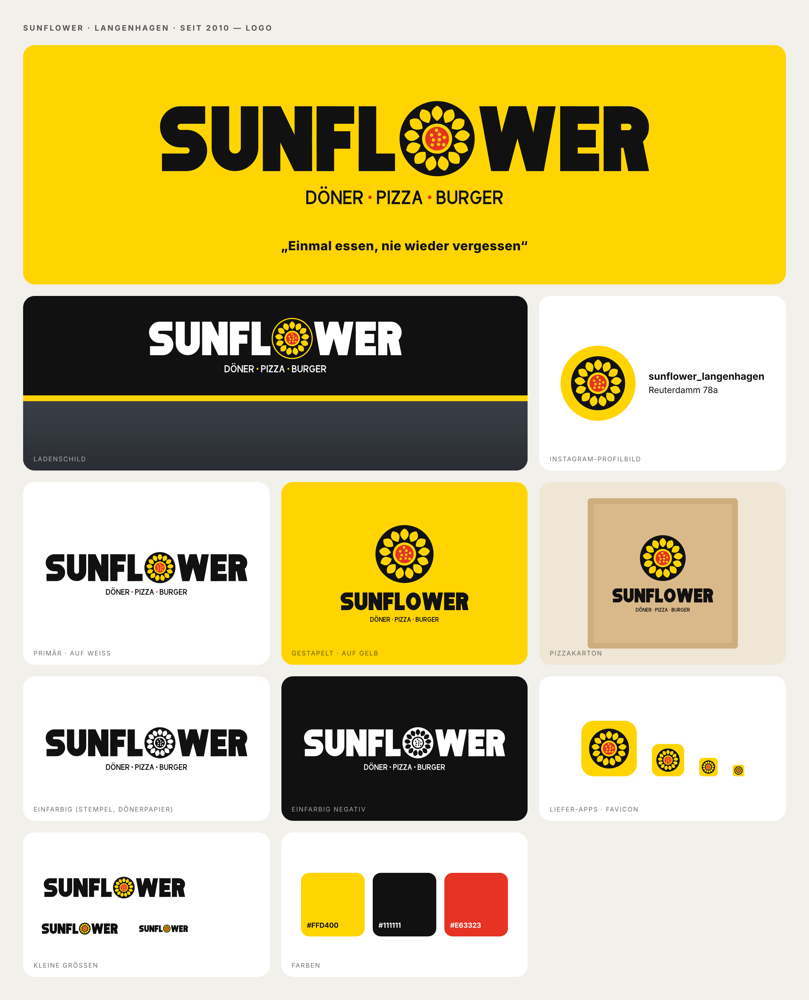

# SUNFLOWER: Logo

This is the logo for **Sunflower**, a döner, pizza and burger restaurant in Langenhagen that has been open since 2010.
Slogan: *„Einmal essen, nie wieder vergessen“*

## Concept
- **Wordmark:** a very bold, geometric "SUNFLOWER" in black. I drew every letter as a vector shape, so the logo doesn't depend on any font.
- **The "O" is a sunflower:** a black disc with 13 yellow petals. The centre is a **pizza seen from above**: a yellow crust, red sauce, and topping dots placed in a sunflower-seed spiral (golden angle).
- **Tagline:** DÖNER • PIZZA • BURGER, set in spaced capitals with red dots between the words.
- The style is flat: no gradients, no 3D and no thin lines. The logo stays readable down to about 20 px.

## Colours
| | Hex |
|---|---|
| Sunflower yellow | `#FFD400` |
| Black | `#111111` |
| Tomato red (accent) | `#E63323` |
| White | `#FFFFFF` |

## Files
| File | Use |
|---|---|
| `svg/sunflower-logo.svg` | Main logo, transparent, for white or light backgrounds |
| `svg/sunflower-logo-on-yellow.svg` | Main logo on yellow |
| `svg/sunflower-logo-on-black.svg` | Shop sign or dark backgrounds (the flower gets a yellow ring) |
| `svg/sunflower-logo-black.svg` | One colour, black (stamp, döner wrap paper, single-colour print) |
| `svg/sunflower-logo-white.svg` | One colour, reversed out (white) |
| `svg/sunflower-wordmark.svg` | Without the tagline, for small sizes |
| `svg/sunflower-stacked*.svg` | Stacked version: pizza box, cups, square formats |
| `svg/sunflower-icon*.svg` | Icon alone: Instagram profile picture, delivery apps, favicon |

The `png/` folder has the same files as PNGs: 2000 px for the logos and 1024 px for the icons.

## Making changes
Run `python3 build.py`. It rebuilds every SVG from the shapes and colours set in the script.
Run `node export.js`. It rebuilds the PNGs and `preview.png` and needs Playwright.
