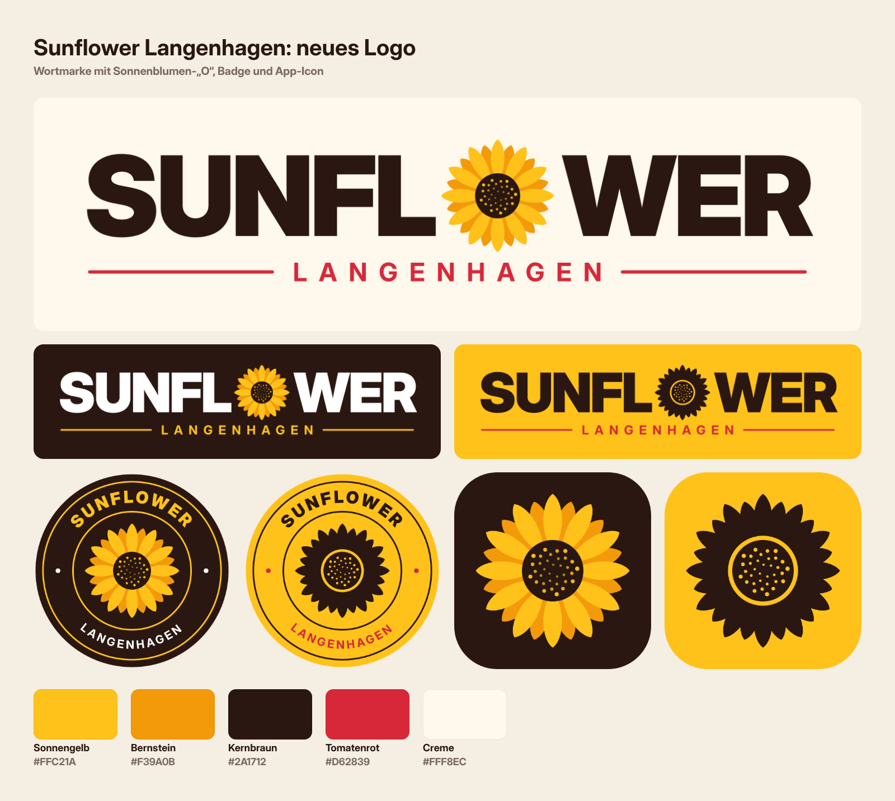

# Sunflower Langenhagen – neues Logo

Neu gestaltetes Logo für Sunflower, Reuterdamm 78a, 30853 Langenhagen.

## Idee
- **Wortmarke:** „SUNFLOWER“ in einer kräftigen, modernen Grotesk (Inter Display Black). Das **O** ist eine Sonnenblume, wie das Motiv-„O“ im aktuellen Auftritt der zweiten Filiale.
- **Sonnenblume:** 12 + 12 Blütenblätter in zwei Gelbtönen, der Kern mit Samen in Fibonacci-Spirale. Sie funktioniert auch allein als Icon.
- **Unterzeile:** „LANGENHAGEN“ in Tomatenrot, das Rot vom Webshop bleibt also erhalten.

## Dateien
| Datei | Einsatz |
|---|---|
| `svg/sunflower-logo-primary(-transparent).svg` | Hauptlogo auf hellem Grund (Website-Header, Speisekarte) |
| `svg/sunflower-logo-dark(-transparent).svg` | Auf dunklem Grund / Fotos |
| `svg/sunflower-logo-yellow(-transparent).svg` | Einfarbig dunkel auf Gelb (Schild, Folierung, Stempel) |
| `svg/sunflower-logo-red.svg`, `svg/sunflower-logo-white.svg` | Weitere Hintergründe |
| `svg/sunflower-badge(-yellow).svg` | Rundes Badge: Instagram-Profilbild, Sticker, Pizzakarton |
| `svg/sunflower-icon(-yellow).svg` | App-Icon / Favicon / Lieferando-Avatar |

Alle SVGs sind in Pfade umgewandelt und brauchen keine Schrift. Die PNGs in `png/` haben doppelte Auflösung (z. B. 2980 × 840 px für das Hauptlogo).

## Farben
| Name | Hex |
|---|---|
| Sonnengelb | `#FFC21A` |
| Bernstein | `#F39A0B` |
| Kernbraun | `#2A1712` |
| Tomatenrot | `#D62839` |
| Creme | `#FFF8EC` |

Schrift: Inter Display (Black / Bold), SIL Open Font License.

Neu erzeugen: `node build.js` (braucht Playwright, Inter Display und `pdftocairo`).
