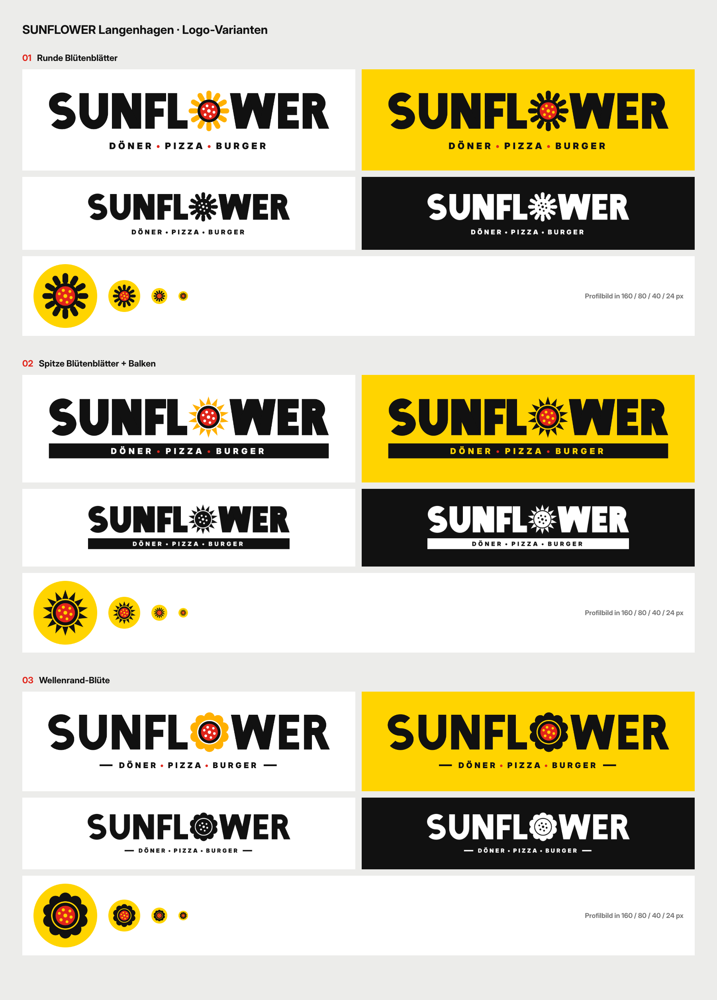

# SUNFLOWER Langenhagen – Logo-Varianten (Runde 3)

Wortmarke „SUNFLOWER“ aus selbst konstruierten, geometrischen Buchstaben (keine fertige Schrift). Das O ist eine flache Sonnenblume mit Pizza-Mitte (Rand, Tomatensauce, Belag-Punkte).

| | Blüte | Unterzeile |
|---|---|---|
| **01** | 12 runde, kurze Blütenblätter | DÖNER • PIZZA • BURGER, rote Punkte |
| **02** | 14 spitze Blütenblätter, etwas fetter | in schwarzem Balken |
| **03** | Wellenrand-Blüte, etwas leichter und weiter | mit kurzen Linien links/rechts |

Je Variante: `-weiss`, `-gelb`, `-einfarbig-schwarz`, `-einfarbig-weiss`, `-profilbild` als SVG (nur Pfade, keine Schrift nötig) und PNG in doppelter Auflösung.

Farben: Gelb `#FFD400`, Blütenorange `#FFB000`, Schwarz `#111111`, Tomatenrot `#E1251B`, Weiß.

Neu erzeugen: `node quelle/export.js <ausgabeordner>` (Playwright, Inter Display Black für die Unterzeile, `pdftocairo`).
